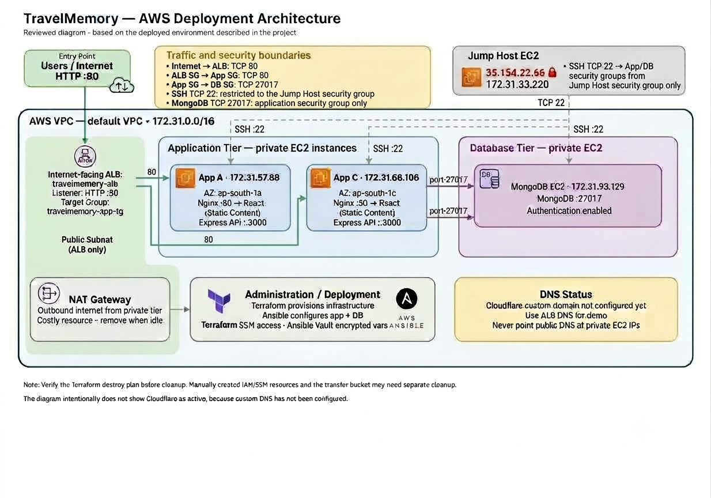

# TravelMemory — AWS Deployment Project

## Project Summary

This project demonstrates the deployment of the TravelMemory MERN application on AWS using Terraform for infrastructure provisioning and Ansible for configuration management and application deployment.

**The AWS infrastructure and application deployment were completed and verified.** The only assignment item not implemented is the custom-domain integration through Cloudflare. The application was tested through the AWS Application Load Balancer (ALB) DNS endpoint.

## Completion Status

| Assignment area | Status | Result |
|---|---|---|
| AWS infrastructure provisioning with Terraform | Completed | EC2 instances, networking, security groups, NAT Gateway and ALB provisioned |
| MongoDB configuration | Completed | MongoDB installed on a private EC2 instance; authentication configured and verified |
| Application deployment with Ansible | Completed | React frontend, Node.js/Express backend and Nginx configured on two application instances |
| Load balancing | Completed | Both application instances registered and healthy in the ALB target group |
| Application validation | Completed | Frontend and API endpoints returned successful responses; database connectivity verified |
| Architecture and evidence documentation | Completed | Architecture diagram, deployment notes and evidence screenshots prepared |
| Cloudflare custom-domain integration | Pending | No custom domain or Cloudflare DNS records were configured |

## AWS Architecture



Editable source: [docs/architecture.drawio](docs/architecture.drawio)

The deployed architecture consists of:

- An internet-facing AWS Application Load Balancer listening on HTTP port 80.
- Two application EC2 instances in separate Availability Zones.
- Nginx serving the React frontend and proxying API requests to Node.js/Express on port 3000.
- A private MongoDB EC2 instance with authentication enabled.
- Security groups limiting application access to the ALB and database access to the application tier.
- AWS Systems Manager (SSM) for administrative access and Ansible connectivity.
- Terraform for infrastructure provisioning and Ansible for repeatable configuration and deployment.
- A NAT Gateway to provide outbound internet access for private resources.

The Cloudflare custom-domain path is intentionally not shown as active because it was not configured during this project.

## Technology Stack

| Area | Technology |
|---|---|
| Cloud platform | Amazon Web Services (AWS) |
| Infrastructure as Code | Terraform |
| Configuration management | Ansible |
| Frontend | React |
| Backend | Node.js and Express |
| Database | MongoDB |
| Web server / reverse proxy | Nginx |
| Load balancing | AWS Application Load Balancer |
| Administration | AWS Systems Manager (SSM) |
| Secrets management | Ansible Vault |

## Repository Structure

```text
.
├── ansible/
│   ├── group_vars/
│   ├── inventory/
│   ├── playbooks/
│   └── templates/
├── docs/
│   ├── architecture.png
│   ├── architecture.drawio
│   ├── deployment-notes.md
│   └── evidence/
├── terraform/
│   ├── main.tf
│   ├── outputs.tf
│   ├── variables.tf
│   └── .terraform.lock.hcl
├── .gitignore
└── README.md
```

Terraform state files, local variable files, provider working directories, backups, private keys and plaintext secrets are excluded from version control.

## Implementation Summary

### 1. Infrastructure provisioning

Terraform was used to provision the AWS infrastructure required by the application, including:

- Application EC2 instances in separate Availability Zones.
- A private database EC2 instance.
- A restricted administration/jump-host instance.
- Application, database and ALB security groups.
- Private subnets and route-table associations.
- A NAT Gateway and Elastic IP.
- An internet-facing Application Load Balancer, listener and target group.

The deployment used the AWS default VPC with CIDR `172.31.0.0/16` and the `ap-south-1` region.

### 2. Database configuration

Ansible configured MongoDB on the private database instance. MongoDB authentication was enabled, and the application database user was configured. The application connection string was managed through encrypted Ansible Vault variables rather than committed as plaintext.

### 3. Application deployment

Ansible deployed the backend and frontend to both application instances. The backend runs as a systemd service, while Nginx serves the React build and proxies API requests to the Node.js/Express backend.

The application instances are accessed through the ALB rather than being directly exposed to public inbound HTTP traffic.

### 4. Administrative access

AWS Systems Manager was used for administration and Ansible connectivity. Ansible Vault was used to protect sensitive database configuration.

## Validation Results

The following checks were completed successfully during deployment:

- Both application instances were reported healthy in the ALB target group.
- The ALB frontend endpoint returned HTTP 200.
- The `/hello` backend endpoint returned HTTP 200.
- The `/trip` API returned HTTP 200 with an empty JSON array.
- A direct MongoDB connection and administrative ping from App A succeeded.
- Both application backend systemd services were active.
- MongoDB authentication was configured and verified.

The empty `/trip` response indicates that the API returned no trip records at the time of testing; it does not indicate seeded sample data.

## Evidence and Documentation

Screenshots covering Terraform provisioning, SSM connectivity, MongoDB configuration, application deployment, ALB target health and frontend access are stored in `docs/evidence/`.

The architecture diagram is available as both a PNG image and an editable draw.io source file.

## Cloudflare Custom-Domain Integration — Pending

The application was verified using the ALB DNS endpoint. A custom domain was not connected through Cloudflare, and DNS records were not created.

For this deployment, the recommended public destination is the ALB DNS endpoint. The application EC2 instances use private IP addresses, so a public A record must not point directly to a private EC2 IP address. A custom-domain implementation would use a CNAME to the ALB hostname (or Cloudflare CNAME flattening for the zone apex), with HTTPS configured before production use.

This is the only identified assignment component left unimplemented.

## Security Considerations

- Terraform state and local `.tfvars` files are not committed.
- Sensitive database configuration is stored in encrypted Ansible Vault variables.
- MongoDB is in a private subnet and accepts application database traffic on port 27017 only from the application security group.
- Application HTTP access is intended to come through the ALB.
- Administrative access is restricted; SSM is used where configured.
- The demonstrated ALB endpoint uses HTTP. HTTPS and custom-domain configuration remain outside the completed scope.

## Cost and Cleanup

EC2 instances, NAT Gateways, Elastic IPs and load balancers can incur AWS charges while running. The deployment evidence and documentation should be retained independently of the live AWS resources.

The Terraform destroy plan was reviewed and showed 22 resources to destroy. Before considering cleanup complete, verify the result in AWS and separately check for manually created resources that Terraform does not manage, including the SSM IAM role/instance profile and the Ansible SSM transfer bucket. The default VPC and unrelated shared resources must not be deleted.

## Submission

This repository contains the Terraform configuration, Ansible playbooks and templates, architecture documentation, deployment notes and evidence screenshots for the completed AWS deployment. The Cloudflare custom-domain integration is explicitly documented as pending.
